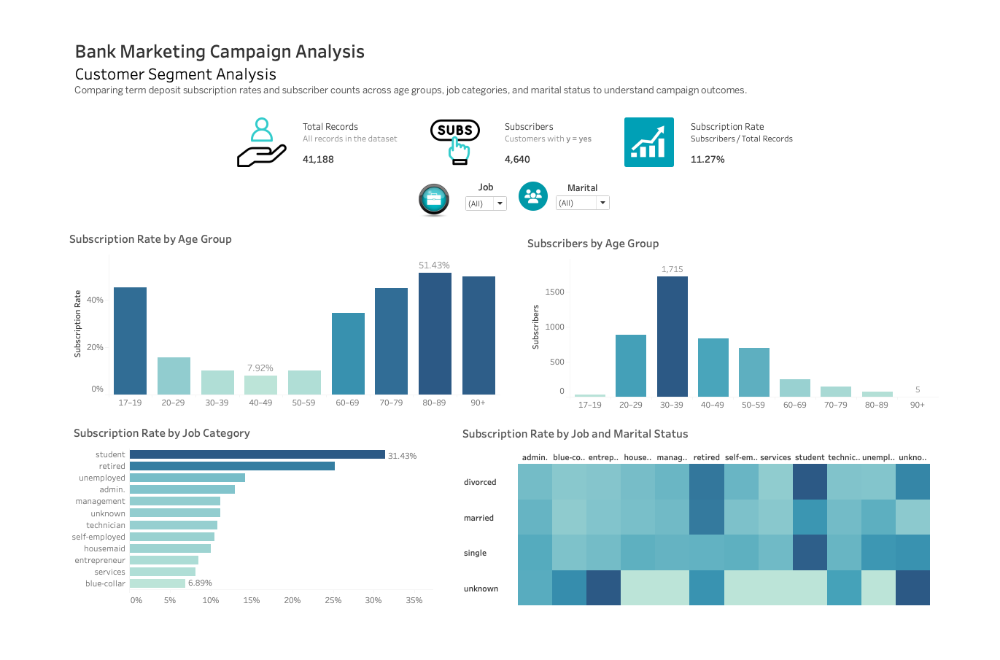
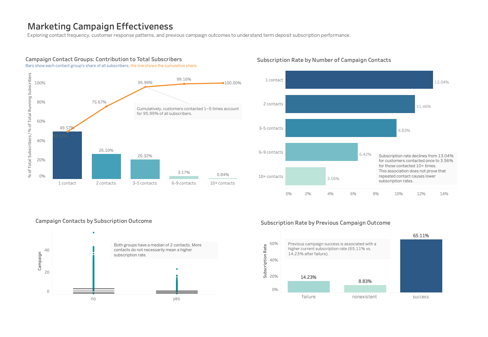

 # Tableau Dashboards — Bank Marketing Analysis

This folder contains the Tableau dashboards developed for the Bank Marketing Customer and Marketing Analysis project. The dashboards explore customer subscription patterns and marketing campaign effectiveness using the cleaned UCI Bank Marketing dataset.

## 1. Customer Segment Analysis

This dashboard examines term deposit subscription patterns across customer demographics and job categories.

**Key visualizations and features:**
- KPI cards showing total records, subscribers, and overall subscription rate.
- Subscription rate by age group.
- Number of subscribers by age group.
- Subscription rate by job category.
- Heatmap of subscription rates by job category and marital status.
- Interactive filters and dashboard actions for exploring customer segments.

## 2. Marketing Campaign Effectiveness

This dashboard investigates the relationship between campaign contact frequency, previous campaign outcomes, and term deposit subscriptions.

**Key visualizations and features:**
- Pareto-style chart showing each campaign contact group's contribution to total subscribers and the cumulative percentage.
- Subscription rate by number of campaign contacts.
- Box plot comparing campaign contact distributions by subscription outcome.
- Subscription rate by previous campaign outcome.
- Dual-axis chart, cumulative percentage calculations, annotations, and informative tooltips.

## 3. Key Findings

- The dataset contains **41,188 records**, including **4,640 subscriptions**, for an overall subscription rate of **11.27%**.
- Student and retired job categories showed relatively high subscription rates among the job categories analyzed.
- Customers aged 30–39 contributed the largest number of subscribers.
- Customers contacted 1–5 times accounted for **95.99% of all subscribers**.
- Subscription rates were lower among customers contacted more frequently during the current campaign.
- Customers with a successful previous campaign outcome had a substantially higher subscription rate than those with a previous failure or no previous outcome recorded.

These findings describe associations in the dataset and do not establish that contact frequency causes a particular subscription outcome.

## 4. Tableau Skills Demonstrated

- Calculated fields and KPI development.
- Bar charts, heatmaps, and box plots.
- Pareto-style charts and dual-axis visualizations.
- Table calculations, running totals, and percentage-of-total calculations.
- Interactive filters and dashboard actions.
- Custom tooltips, data labels, and annotations.
- Dashboard layout, visual hierarchy, and data storytelling.

## 5. Data Source and Preparation

The analysis uses the cleaned dataset prepared with SQL and exported for Tableau.

- **Original dataset:** [UCI Machine Learning Repository — Bank Marketing](https://archive.ics.uci.edu/dataset/222/bank+marketing)
- **SQL documentation and analysis:** [`sql/README.md`](../sql/README.md)
- **Dataset documentation:** [`data/README.md`](../data/README.md)

## 6. Tableau Public Workbook

[**View the Bank Marketing Campaign Analysis Workbook**](https://public.tableau.com/app/profile/claudia.zelaya/viz/Bank_Marketing_Campaign_Analysis/BankMarketingCampaignAnalysis)

## Analytical Note
Subscription rates and subscriber counts provide different perspectives on campaign performance. Customer segments with higher rates do not necessarily contribute the largest number of subscribers. All findings should be interpreted in the context of the dataset and its observational nature.
